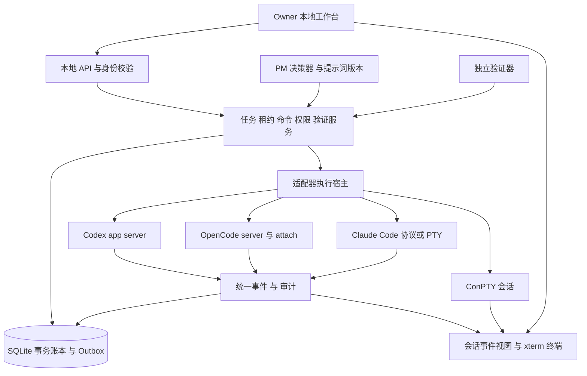

# 开发协作平台系统设计

## 架构概览

采用本地控制平面、隔离执行工作区和可视终端。PM 使用模型提出计划和任务，但任务状态、输入归属、权限及重试规则由确定性代码执行。

此图表示目标架构；初始开发先实现不依赖网络的核心账本和协议探针，界面及完整适配按里程碑推进。

## 组件职责

| 组件 | 职责 | 禁止承担的职责 |
|---|---|---|
| Core | 需求、任务 DAG、租约、命令账本、审批与验证规则 | 自行猜测模型任务是否完成 |
| PM | 拆解、上下文打包、返工指导、协调、知识更新 | 直接编辑业务代码、执行 Git 写操作、批准超出授权范围的操作 |
| Runner | 进程启动、受控 stdin/协议发送、输出读取、进程树回收 | 任意 shell 拼接用户输入 |
| Adapter | 探测 CLI 版本，翻译供应商协议和状态事件 | 修改平台任务最终完成状态 |
| Verifier | 在指定提交上运行受控验证，记录证据 | 把 Agent 自报测试通过当成独立验证 |
| Knowledge | 按提交/文件哈希更新 L1/L2/L4，返回来源及新鲜度 | 用过期索引隐瞒当前变更 |
| UI | 需求与任务、三列 Agent 工作区、PM 对话、权限与诊断 | 绕过控制服务直接写进程输入 |
| Provider Resolver | 从已授权配置或凭据仓库取得运行时密钥 | 将密钥返回 UI、历史提示词或诊断包 |

PM 可在现有需求和约束内组织并裁定技术争议，须说明依据并生成落实任务。业务范围、付费资源、不可逆发布和已授权范围外操作交 Owner；其他就绪任务继续。PM 可修改自己的知识记录和视图，业务文档合并重组由执行 Agent 完成。

## 技术选择

主服务采用 Python 3.12、FastAPI、SQLite WAL，文件存交付物与终端分片，数据库存元数据和事务事实。Windows 终端宿主通过 ConPTY 实现；可使用受测试的 pywinpty 封装，安装不可用时不宣称终端完成。前端目标为 TypeScript、React、xterm.js，通过本机浏览器或后续 WebView2 外壳承载。首版不依赖云托管，不引入网站发布服务。

业务事件使用 SSE 并支持 Last-Event-ID；终端二进制/UTF-8 流、resize 与控制用 WebSocket。终端不使用 SSE 代替双向输入。MCP 是核心服务的薄桥接；所有授权和状态校验仍在 Core。

## 决策记录

| 决策 | 结论与理由 | 替代方案 |
|---|---|---|
| ADR-01 | 首版含可视会话工作区，满足新增用户需求 | 原“仅 CLI”改为开发阶段，不作为产品验收终点 |
| ADR-02 | 协议优先，PTY 保留；模式在会话启动时选择 | GUI 键鼠只作为明确启用的兼容适配 |
| ADR-03 | 不嵌入外部终端窗口 HWND；自行渲染 ConPTY 输出 | SetParent 易产生 DPI、焦点、生命周期问题，未作为稳定方案 |
| ADR-04 | 单 SQLite 事务写入业务状态、事件和 Outbox | 多份 YAML 不作为并发事实源 |
| ADR-05 | 调度确定性，PM 输出结构化计划经验证后入库 | 不让自由文本直接更改状态/执行 shell |
| ADR-06 | 以至少一次事件投递配合幂等处理；外部输入状态不明需对账 | 不承诺跨供应商端到端 exactly-once |
| ADR-07 | 风格来自脱敏规则与少量示例，不做微调 | 原始跨项目对话不导入运行时上下文 |
| ADR-08 | 用户授权下在项目私有工具目录安装 Claude；智谱连接单独探测 | 不修改全局 Agent 配置、不禁用原生审批 |

## 可视工作区交互

顶部显示项目、目标、当前阶段及“暂停调度”。左侧是需求与任务；中央每个 Agent 一张工作区卡：类型/版本、分支、工作目录、任务、模式、输入所有者、状态、最后事件时间。卡片可放大为原生终端流或协议会话流。右侧 PM 对话与待决事项。

每次 PM 发出的指令先出现在命令时间线，再显示排队/发送/接受状态。用户选择目标工作区后输入，发送前目标固定到 session_id，不随焦点切换而改变。“接管”原子切换输入租约，撤销尚未发送的 PM 命令；已经发送的回合需中断并确认停稳，再接收新输入。“交还 PM”生成上下文摘要，经人工确认后继续调度。

协议模式显示相同会话的公开消息和工具事件，但不伪称外部 TUI 已显示。若使用 OpenCode attach，必须核对 server URL、session_id 和工作目录，确认 UI 与控制协议指向同一会话。Codex 原生 TUI 与 app-server 是否能同时安全附着同会话，未验证前不混用。

## 进程与工作区生命周期

Owner 启动服务 → 生成本地访问令牌 → 探测适配器 → 打开项目 → 检查 Git → 创建独立 Worktree → 启动 Agent → 注册实例 → 获取输入租约 → 分派任务。每个 Runner 用 Windows Job Object 管理进程树，退出回收子进程；服务重启不能只凭 PID 重连，必须核对启动时间、会话标记、目录与供应商会话 ID。

关闭 UI 默认保留服务与任务；“退出并停止”明确中断工作并记录快照。服务关闭期间不接受新派发，处理或标记未确认输入，保留日志。若断电，下一次启动执行恢复流程，而不是重新运行上次整条指令。

